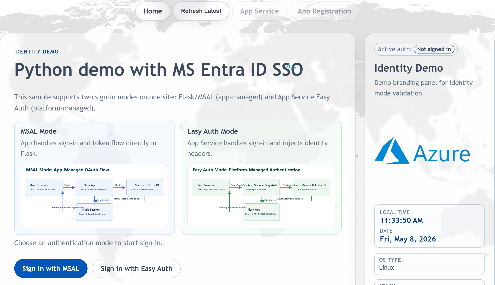
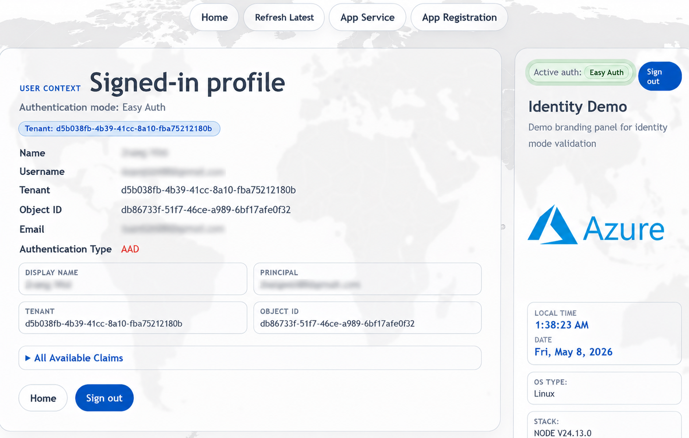
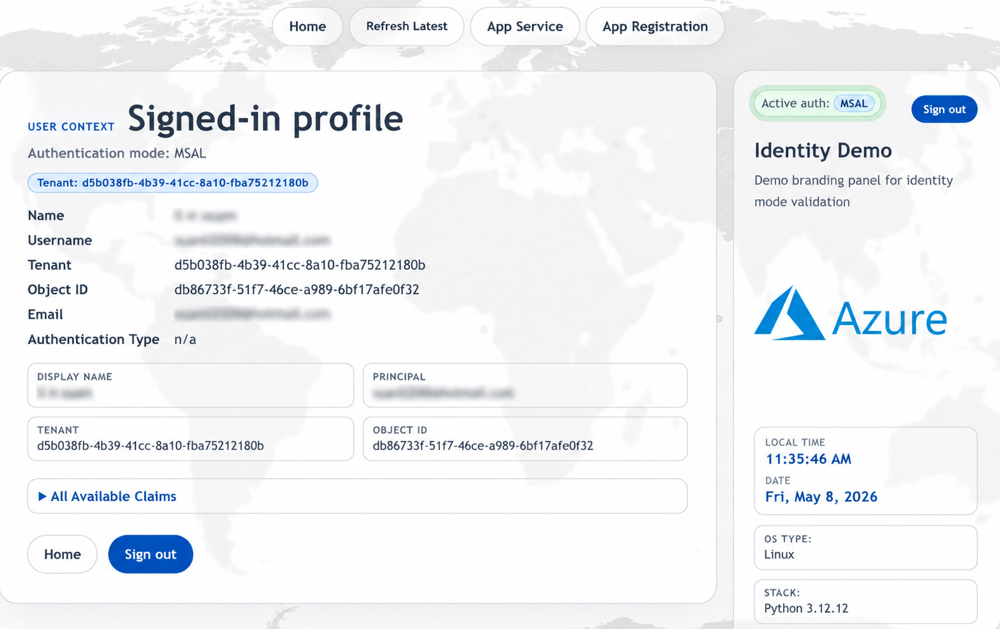

# web-ccoedemo-python

Flask implementation of the `web-ccoedemo` Microsoft Entra authentication demo.

## Screenshot





## Current Scope

- Demonstrates MSAL and Easy Auth flows in one Python web app
- Uses `app.py`, `templates/`, and `static/` as the main app surface
- Deploys through both Azure DevOps pipelines and GitHub Actions in this repo
- Includes additional architecture, pipeline, and deployment notes in `docs/`

## Key Files

- `app.py`
- `requirements.txt`
- `requirements-dev.txt`
- `tests/`
- `templates/`
- `static/`
- `.github/workflows/azure-webapp.yml`
- `.github/workflows/container-image.yml`
- `Dockerfile`
- `azure-pipelines.yml`
- `run_from_package.yml`
- `docs/`

## Documentation

Start with the documentation map:

- [Documentation Map](docs/README.md): best entry point for the full documentation set

Core documents:

- [Architecture](docs/10-architecture/architecture-overview.md): app structure, auth modes, runtime behavior, and deployment architecture
- [Pipelines](docs/40-pipelines/pipelines-guide.md): GitHub Actions plus both Azure DevOps pipeline paths in this repo
- [Deployment Methods](docs/30-deployment/deployment-methods.md): side-by-side comparison of supported deployment styles
- [Validation](docs/70-validation/validation.md): repository scan and validation notes
- [Security](SECURITY.md): trust boundaries, secret handling, CI/CD controls, and reporting

Suggested reading paths:

- Understand the app: [README](README.md) -> [Architecture](docs/10-architecture/architecture-overview.md) -> [Validation](docs/70-validation/validation.md)
- Understand CI/CD: [README](README.md) -> [Pipelines](docs/40-pipelines/pipelines-guide.md) -> [Deployment Methods](docs/30-deployment/deployment-methods.md)
- Choose a deployment pattern: [README](README.md) -> [Deployment Methods](docs/30-deployment/deployment-methods.md) -> [Pipelines](docs/40-pipelines/pipelines-guide.md)

## Deployment

Four deployment methods are documented for this app:

- GitHub Actions self-contained ZIP deploy with `WEBSITE_RUN_FROM_PACKAGE=1`
- Azure DevOps pipeline ZIP deploy with Oryx build
- App Service source control sync from Azure DevOps Git
- App Service Run From Package

See [Deployment Methods](docs/30-deployment/deployment-methods.md) for the full comparison and operational details for each method.

For the repo-managed CI/CD flows specifically, see [Pipelines](docs/40-pipelines/pipelines-guide.md).

The container workflow builds and publishes `ghcr.io/<owner>/<repository>`
on pushes to `main`, tagged with `latest` and the full commit SHA. In a mirrored repo it
uses that repo's owner and name, so the mirror's `GITHUB_TOKEN` publishes to its own GHCR
package. It can also be run manually from GitHub Actions. To build locally, run
`docker build -t web-ccoedemo-python .`.
The container listens on port `8000`; configure `FLASK_SECRET_KEY` and any required
Entra settings in the runtime environment rather than baking them into the image.

## Local Validation

```powershell
python -m venv .venv
.\.venv\Scripts\python.exe -m pip install -r requirements.txt -r requirements-dev.txt
.\.venv\Scripts\ruff.exe check .
.\.venv\Scripts\ruff.exe format --check .
.\.venv\Scripts\python.exe -m pytest
.\.venv\Scripts\pip-audit.exe -r requirements.txt
```

Set `FLASK_SECRET_KEY` before running the app. Production startup on Azure App Service
fails closed when this setting is absent.

## Local Run

```powershell
$env:FLASK_SECRET_KEY = 'replace-with-a-local-development-value'
.\.venv\Scripts\python.exe -m flask --app app run
```

The minimum MSAL configuration is `AAD_CLIENT_ID`, `AAD_CLIENT_SECRET`, and
`AAD_TENANT_ID`. `AAD_REDIRECT_URI` is optional; when omitted, the app derives it from
the request host and `AAD_REDIRECT_PATH` (default `/auth/callback`). Do not enable
`TRUST_EASY_AUTH_HEADERS` unless a trusted authentication proxy strips and supplies
those headers.

## Notes

- GitHub Actions authenticates to Azure with service-principal credentials stored as protected environment secrets.
- GitHub Actions targets a required primary Linux App Service plus optional secondary and third targets; Azure DevOps uses branch-specific targets.
- Azure DevOps deploys `sbx` only to Sandbox and `dev` only to Dev; `main` is build-validated but has no production deployment stage in the checked-in pipeline.
- The alternate `run_from_package.yml` pipeline still includes an optional third target for package-mounted deployments.
- Optional targets are skipped safely when blank or not found.
- GitHub Actions builds a self-contained package with vendored Python dependencies and deploys it with `WEBSITE_RUN_FROM_PACKAGE=1`; the main Azure DevOps pipeline deploys source and enables App Service/Oryx build automation.
- Deployments have been validated successfully against Linux App Service Python 3.12 runtime stacks.
- This repo is application-focused and does not have a root Terraform stack.
- CI and pre-commit enforce formatting, linting, tests, YAML/file hygiene, and dependency vulnerability auditing.
